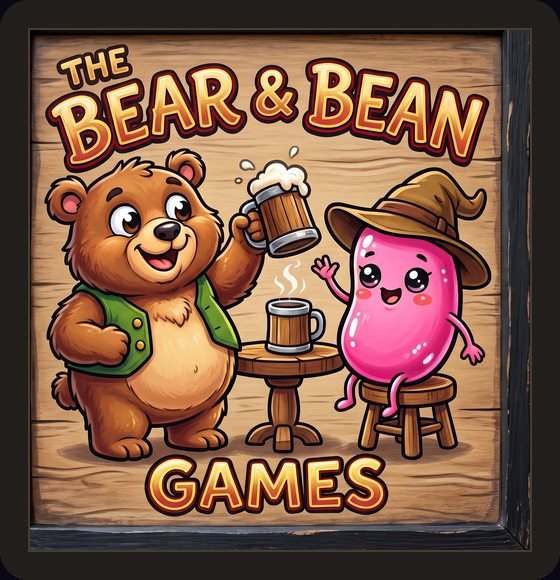

# The Bear & Bean Games



The Bear & Bean Games: just wholesome mini-games that work offline. Totally free, with no ads, no monetisation and no tracking. Made for touch screens; each game lives in its own folder with no build step and is a single self-contained HTML file.

Play at https://crunchy000.github.io/Games/

| Game | Folder | What it is |
| --- | --- | --- |
| Royal Jelly | [`royal-jelly/`](royal-jelly/) | Queen Bean logic puzzle: crown one Bean per row, column and colour patch, with no two Beans touching. Generated boards from 6×6 to 9×9, each with exactly one answer, plus a daily 8×8, dots, hints, undo and best times. |
| Thin Ice | [`thin-ice/`](thin-ice/) | Bear and Bean both stand on a frozen pond and take turns knocking out blocks (unsupported blocks drop too) or hopping to a safer block. First to sink the other wins; sink yourself and you lose. Three pond sizes, undo, and a computer opponent. |
| Bean Grab | [`bean-grab/`](bean-grab/) | Two players on one phone laid flat: tap your half to send your hippo chomping at rolling jelly beans. Gold beans are worth 3. Also plays against the computer. |
| Guess Five | [`guess-five/`](guess-five/) | Five-letter word puzzle in six guesses with a daily word and endless mode, hard mode, high-contrast colours, stats and sharing. British English word list. |
| Word Hive | [`word-hive/`](word-hive/) | Honeycomb word puzzle: make words from seven letters using the centre letter. 200 hives (a new one each day), ranks, hints grid and bonus words. |
| Sudoku | [`sudoku/`](sudoku/) | Sudoku with puzzles generated on the fly (always one solution), four difficulty levels, notes, hints, undo, mistake checking and best times. |
| Bean Merge | [`bean-merge/`](bean-merge/) | Sliding merge puzzle on a 4×4 wooden board: matching jelly beans merge and double, up to the golden 2048 bean and beyond. Undo, best score and saved games. |
| Stack Drop | [`stack-drop/`](stack-drop/) | Hold to send Bean (the jelly bean) bouncing down a spinning papercraft tower of sweets; let go before the liquorice. Keep going for a sugar rush that breaks through anything. Endless levels, with Bear cheering you on. |
| Tangle Tails | [`tangle-tails/`](tangle-tails/) | Untangling puzzle: tap snakes to slither them off the board in the direction they face. Blocked snakes bonk and cost a heart, so free them in the right order. Endless solvable levels, hints and star ratings. |
| Slither Slide | [`slither-slide/`](slither-slide/) | Maze-painting puzzle: swipe a cartoon snake that slides until it hits a wall, painting every tile it crosses. Endless solvable levels, star ratings and six unlockable snakes. |
| Hedge Hop | [`hedge-hop/`](hedge-hop/) | Endless crossing game: hop a hedgehog over roads, log-filled rivers and railway lines, collecting berries. |
| Bumble Dash | [`bumble-dash/`](bumble-dash/) | One-tap flyer: keep a bee aloft through gaps between honeycomb towers; grab pollen for bonus points. |
| Ink Bounce | [`ink-bounce/`](ink-bounce/) | Blueprint brick breaker with no paddle: draw one line at a time with limited ink; neat lines refund ink, and falling ink drops and pots refill it. |
| Pyramid Hop | [`pyramid-hop/`](pyramid-hop/) | Help the hedgehog hop around a mossy temple in the rainforest, changing every stone while dodging critters. Hop off and a toucan always swoops in to catch you. |
| Tile Burst | [`tile-burst/`](tile-burst/) | Block puzzle: drag pieces onto an 8×8 board, fill rows and columns to burst them, and chain combos. |
| Dot Loop | [`dot-loop/`](dot-loop/) | Connect same-coloured dots; close a loop to clear every dot of that colour. Levels plus a 60-second dash. |
| Gummy Pop | [`gummy-pop/`](gummy-pop/) | Match-3 puzzle: make rockets, bombs and rainbow orbs; bring honey pots down to Bear, break liquorice locks, clear sugar cubes and spreading chocolate. Lolly Pop and Free Swap boosters, +5 moves once per level. |
| Bear vs Bean (Dots and Boxes) | [`dots-and-boxes/`](dots-and-boxes/) | Two-player pass-and-play: Bear and Bean take turns joining dots; close a box to stamp it with a paw print or a bean and go again. Renamable players, win tally, undo. |

Ideas for future games are in [`TODO.md`](TODO.md).

The root `index.html` is a landing page with a featured carousel and a scrolling row of games for each category (Word & number, Puzzle, Action & Arcade, Bear vs Bean). To add a game, add its folder, a `<template id="art-<folder>">` thumbnail and an entry in the `GAMES`/`CATS` lists in that file.


## Controls

- **Touch:** drag to move, tap to act. Each game shows its controls on the title screen.
- **Keyboard:** arrow keys or WASD, plus space.

## Play offline (install as an app)

The arcade is a Progressive Web App. Open it once in a browser and every game is downloaded in the background, so the whole arcade then works with no connection.
- **Android (Chrome):** tap **Install app** on the home page, or use the browser menu → *Install app*.
- **iPhone/iPad (Safari):** tap **Share → Add to Home Screen**.

Each game has a home button that returns to the arcade, since an installed app has no browser back button.

How it works: `sw.js` (the service worker) saves the home page, every game and the icons when the app is first opened. Pages are served from that saved copy straight away and refreshed in the background when online. `manifest.webmanifest` and `icons/` provide the app name and icons.

**After adding or changing a game**, run `python3 tools/update-sw.py`. It rebuilds `sw.js` with the full list of games and a new version stamp, so installed copies download the update in one go. Edit `tools/sw-template.js` rather than `sw.js` itself.

## Hosting on GitHub Pages

Settings → Pages → Build and deployment → Source: **Deploy from a branch**, Branch: **main**, folder **/ (root)**.
The site will then be at `https://<user>.github.io/Games/`. The empty `.nojekyll` file tells Pages to serve the files as they are.

## Running locally

Open any `index.html` in a browser, or serve the folder:

```sh
python3 -m http.server 8000
```


### Word lists

Guess Five and Word Hive use British English word lists derived from [SCOWL](https://github.com/en-wl/wordlist) (Spell Checker Oriented Word Lists) by Kevin Atkinson and contributors, used under its licence (see [`WORDLISTS-COPYRIGHT.txt`](WORDLISTS-COPYRIGHT.txt)). Commonness levels from SCOWL decide which words are answers and which are accepted as extra guesses or bonus words.
